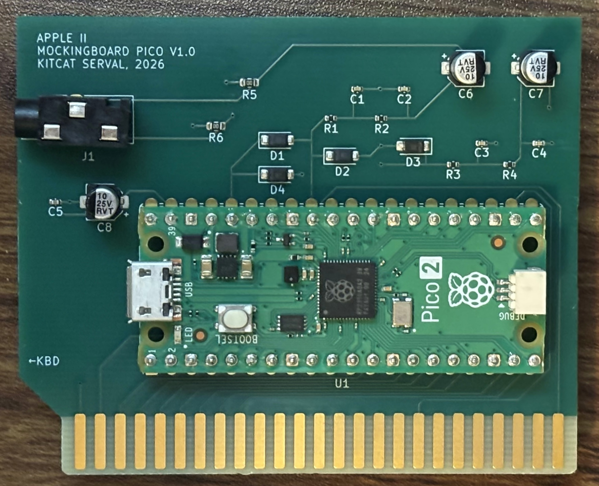

# Mockingboard Pico

A Mockingboard C-compatible stereo sound card for the Apple II built on a Raspberry Pi
Pico 2 (RP2350), with both AY music and SSI-263 speech. The Pico 2 snoops the
Apple II peripheral slot bus, emulates the card's two 6522 VIAs and two
AY-3-8910 PSGs, decodes SSI-263 speech, and outputs stereo PWM audio.

The audio is line-out and most compatible with powered, television, or headphone
speakers. Unpowered speakers will be quiet.



## Tested Software

The card has been tested on an Apple //e with software that stresses different
detection and play methods.

|Example Programs|Tests|
|-|-|
|Total Replay|Auto-detection via interrupt timer polling|
|Berzap!|SSI-263 speech + AY music in the same program|
|Ultima III / IV|Manual card setup that stresses interrupt handling|
|Ultima V|Dual-card AY music support|
|Sweet Micro Systems Speech Development System|The SSI-263 speech synthesizer|
|Willy Byte In The Digital Dimension|Interrupt-driven SSI-263 speech + AY music|
|[Independence](https://github.com/WhitneyDesignLabs/independence)|Polled SSI-263 speech + AY music|
|[SSI-263 Speech Test (dos33fsprogs)](https://github.com/deater/dos33fsprogs)|SSI-263 speech|
|[Apple // Bejeweled](https://github.com/jeremysrand/a2bejwld)|SSI-263 speech|
|Apple Cider Spider|AY music|
|Popeye|AY music|
|Broadsides|AY music|
|Bank Street Music Writer|AY music|
|Skyfox|AY music|
|[Plasmagoria](http://fr3nch.t0uch.free.fr/)|AY music|
|[Raster Bars](http://fr3nch.t0uch.free.fr/)|AY music|
|[(Not So) Cheap Tunes](http://fr3nch.t0uch.free.fr/)|AY music|

These cover both ways a title finds the card (automatic detection and manual
selection), both audio paths (AY music and SSI-263 speech), and
interrupt-detection behaviors.

## Flashing

The latest firmware can be found on the [releases](https://github.com/kue-m/mockingboard-pico/releases) page.

Remove the Mockingboard Pico from the Apple II before connecting it to USB.

1. Connect the Pico 2 to a computer with a Micro USB cable while holding the
   BOOTSEL button.
2. Release BOOTSEL. A new drive for the RP2350 will appear.
3. Copy `mockingboard_pico.uf2` onto that drive.
4. The Pico 2 will reboot into the new firmware automatically.

## Version

There are two methods of printing the firmware version:

1. Run `mbpico-version-check.po` on your Apple II and type the Mockingboard Pico's
slot number when prompted.
2. Use `picotool info` to read the UF2's binary info.

Modified or untagged releases report the commit hash after the version number.

## Building Firmware

### Docker

To build without installing a toolchain (via pinned pico-sdk 2.2.0, picotool
2.2.0, and Arm GCC):

```
docker build -o dist .
```

This runs the host tests, builds the firmware, and writes
`dist/mockingboard_pico.uf2`.

### Local Toolchain

Requires the Pico SDK, `arm-none-eabi-gcc`, and CMake. Point `PICO_SDK_PATH` at
your SDK checkout, then:

```
make prod        # builds release image
make clean       # remove all build directories and host artifacts
```

The build tree lands in `dist/build/prod/` and the flashable image is copied to
`dist/mockingboard_pico.uf2` (the same path the Docker route produces). `make` with
no target runs the host tests.

## Board

The gerbers and schematic are provided in `board/` for custom printing and assembly.

|Reference|Part|Notes|
|-|-|-|
|U1|Raspberry Pi Pico 2|-|
|J1|PJ-320F audio jack|Use the [3-pin variant](https://a.co/d/068c63gA)|
|C1-C4|10nF ceramic capacitor|Labeled `103`|
|C5|100nF ceramic capacitor|Labeled `104`|
|C6-C8|10µF 25V electrolytic capacitor|-|
|R1-R4|1kΩ 1/4W resistor|-|
|R5-R6|100kΩ 1/4W resistor|-|
|D1-D4|1N4148W diode|-|

## Theory of Operation

The card occupies one Apple II peripheral slot and answers accesses to that slot's
`$Cn00` I/O page (`n` is the slot number). All bus lines are wired to contiguous
GPIOs so a PIO state machine can latch the whole bus in one instruction.

### GPIO mapping

|GPIO|Signal|Direction / role|
|-|-|-|
|GP0-GP7|D0-D7|Bidirectional data bus|
|GP8-GP15|A0-A7|Address, input from the Apple II|
|GP16|/IOSEL|Input; low selects the card's `$Cn00` page|
|GP17|R/W|Input; high = read, low = write|
|GP18|PHI0|Input; phase-0 bus clock|
|GP19|/RES|Input; low = Apple II reset|
|GP20|/IRQ|Open-drain output; interrupt request|
|GP26|PWM L|Audio output, left (ADC-only pin)|
|GP27|PWM R|Audio output, right (ADC-only pin)|

### Firmware

The two cores are split by role: core0 services the slot bus in a tight loop while
core1 runs from RAM and renders audio. A lock-free queue links them, so neither core
stalls the other.

core0 drives three PIO state machines, all on one PIO. On the falling edge of
`/IOSEL` the *addr* machine latches the address, `/IOSEL` and R/W. On a write the
*write* machine captures D0-D7 after a fixed settle delay (about 320 ns at 200 MHz).
On a read the *read* machine drives D0-D7 with a core-supplied byte for as long as
`/IOSEL` is asserted. A second PIO runs the two 6522 Timer1 counters and a
free-running bus-cycle counter.

Each access is serviced against a behaviorally faithful W65C22 VIA model
(`firmware/src/mb_via.c`). The two modeled VIAs feed two AY-3-8910 PSGs (the
`emu2149` core) across a lock-free queue, and core1 mixes them to stereo PWM audio.
SSI-263 speech is decoded separately (`firmware/src/mb_speech_bus.c`) and
synthesized in real time (`firmware/vendor/ssi263/`); a periodic core0 poll turns
its A/R request into a 6522 CA1 interrupt.

Reading the Timer1 counter (`$Cn04`/`$Cn05`) is the one timing-critical access:
titles that auto-detect the card read it back-to-back and expect a fixed response
time. It is answered by a frozen hand-written assembly fast-path
(`firmware/src/mb_fastread.S`) whose instruction sequence cannot shift when
surrounding code is recompiled.

## License

MIT (see `LICENSE`). This project also incorporates third-party components (in
`firmware/vendor/` and a few `firmware/src/` files), each under its own MIT
license; `LICENSE` lists them.